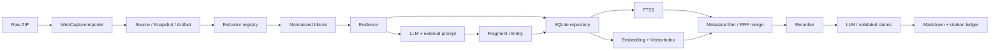

# Prototype用暫定仕様

## v0.2の現行仕様

現行の既定処理は[Prototype Upgrade](PROTOTYPE_UPGRADE.md)に記載する。全EvidenceのHighRecall抽出、Page Context、0件理由とCoverage、構造化Final、再開可能な[ローカルAI比較](../../../benchmark/README.md)を追加した。Migrationは002を追加し001と旧世代を保持する。

以下は初回v0.1の設計・評価条件の記録として残す。上位Evidence選択と検索上位のFinal生成は現在の既定ではなく、CLIの`--legacy`で選択する比較用方式である。

## 範囲と境界

正本は `docs/cpc-prototype-minimum-requirements` の要件定義書v0.2（`1561a7d`）です。今回のFeature Branchで取り込みました。最終Schema、最適モデル、GUI、大規模運用は確定しません。

`src/sgokb/application.py` がCLI/将来GUI共通のサービス、`domain.py` がSQLとHTTPに依存しない値・Protocol、`repository.py` がSQL、`providers.py` が外部モデル接続です。`extraction.py` にExtractor registry、`search.py` にVectorIndex/Rerankerの境界を設けました。既存拡張機能・Native HostへSGOKB依存を追加していません。

## 永続化とMigration

| テーブル | 主な情報・参照 |
|---|---|
| sources | 実URL（unique）、site、source_type |
| snapshots | Capture UUID、Source、title/time、原ZIPパス/hash、manifest/metadata、active_run |
| artifacts | Snapshot内相対パス、checksum、byte数 |
| normalized_runs | Snapshot、Extractor/Normalization/Chunk設定、構造Block JSON |
| evidence | UUID、Normalized世代、Source/Snapshot、content/hash、位置/Section metadata |
| entities | UUID、拡張可能なtype文字列、name、aliases。type/nameでunique |
| entity_relations | subject/predicate/objectとmetadata。Character→Work等 |
| entity_evidence | EntityとEvidenceの多対多関連 |
| ai_runs | task/model/revision/prompt/version/schema/input/output/time/status/error |
| fragment_runs | Entity/Snapshot/Normalized世代/AI履歴、設定、activeフラグ |
| fragments / fragment_evidence | facet/content/hash/metadata/time、根拠Evidence多対多 |
| search_items / search_fts | Evidence/Fragmentの共通検索行、FTS5 trigram索引 |
| embedding_spaces / embeddings | model/revision/dimension/configuration、対象行/世代/hash/vector/time |
| documents | Entity、AI履歴、Markdown、引用マップ、検索設定・選択材料 |
| schema_migrations | 適用済みMigration番号 |

SQLはRepositoryに集約しています。追加Migrationは `migrations/NNN_description.sql` に置き、番号順に各MigrationをTransactionで適用します。SQLite標準ライブラリを使い、初回の小さなSchemaにORM/Alembicを追加する負担を避けました。外部キー・WAL・busy timeoutを有効化しています。同じDBに複数の更新ジョブを並行実行する運用は今回評価していません。

RawをDBへ複製しません。元ZIPの参照とSHA-256、各Artifact索引を保存します。原ZIPを移動する際の参照修復CLIは今後の課題です。

## Importer

標準ZIPを展開せず読み取り、v1.0のみ明示受理します。UUID v4・Capture日時・規定ファイル名・Main DOM状態・必須Artifact・MHTML状態・Frame参照・全Artifact checksumを検証します。重複entry、不正パス、未知Artifact、512MiB超の圧縮/展開サイズは拒否します。CRCはZIP readerが検証します。

同一capture_id/同一原ZIP hashは二重登録しません。同じIDで別内容は衝突として拒否します。URLはcanonicalで置き換えず、同じ実URLはSourceを共有してCaptureごとにSnapshotを作ります。RawがImport後に変化した場合は再処理を拒否します。

siteはURLのhost、source_typeは百科事典/wiki/bbs/blog/news/social等の小さな規則で判定し、不明なサイトは `generic_web` にします。公式サイトの網羅的な判定は未実装です。追加規則はDB Schema変更を要求しません。

## Extraction / Normalization / Evidence

BeautifulSoupのHTML parserを使用し、UTF-8のRendered DOMとして明示decodeします（元ページのcharsetメタタグに誤って従わない）。Genericに加えWikipedia本文root、Pixiv百科事典article rootを実装しました。その他はGenericへfallbackします。

script/style/nav/footer/aside/form等の既知のUIだけを派生DOMから削除します。本文候補はmain/role=main、単一の十分長いarticle、bodyの順です。テキストをLLMでクリーンアップしません。

Blockは kind/content/section/position/artifact/metadata を持ちます。heading/paragraph/list/table/quote/code/postを識別し、投稿のlinks/time/idを保持可能にしました。汎用掲示板のCSS class等だけでは全サイトの投稿境界・返信関係を完全に復元できません。

位置はRaw DOMのタグと兄弟indexから清掃前に算出するpathです。EvidenceはBlock位置配列、Section、Artifact、文字offset、構造種別・metadataを保持します。短い同Sectionのparagraph等をまとめ、table/list/quote/postは境界を維持し、1000文字を超える単位だけ100文字overlapで分割します。文字数はtoken数ではありません。日本語の概略サイズを把握しやすく、最初の処理を単純にする暫定値です。長い表は文字分割なので行単位の再設計が必要です。

Main DOMのみが既定です。Frame/Shadowは広告・計測UIが多いため、明示オプションで加えます。含める場合はFrame ArtifactとShadow索引index/host_pathを位置へ記録します。JSON-LDはmetadataとしてRaw参照とともに保持し、不正JSON-LDの修復や意味抽出は行いません。MHTMLはRaw補助資料であり本文抽出には使用しません。

## Fragment / Entity / Prompt

Entity TypeとFacetを自由文字列にし、WorkとCharacterを別固定テーブルに分けません。CharacterとWorkの関係は論理relationです。抽出対象EntityはCLI指定、評価では少数の既知のテーマをサンプルtitleから選びます。自動Entity発見の最終方式ではありません。

Fragment入力はEntity名/aliasの出現、Section内のEntity名、paragraph/table/quote/post等の構造を併用して選び、既定6件/5000文字に制限します。関連イラスト・小説などのSectionは優先度を下げます。単純な名前の出現回数ではファン作品一覧が本文より優先されたためです。評価は3件/3000文字です。対象Entityに関係しない場合は空結果を許します。情報を網羅する抽出ではなく、根拠付きの少数Factを生成する暫定方式です。

Promptと出力Schemaは `src/sgokb/prompts/` の交換可能なファイルです。Prompt先頭versionに内容hashとSchema hashを加えて履歴に保存します。出力Schemaによる形式制約に加え、Coreが内容・facet・根拠IDを検証します。LLMが生成した未提供IDは保存しません。Prompt内でRaw本文を命令として扱わない旨を指示していますが、内容の事実性まで形式検証で保証できません。

AI ledgerはPrompt本文、実際のpayload・期待response schema、temperature/output上限/応答形式override等の設定、実出力、model/revision、時刻と成否を記録します。HTTP/parse/schema/storage失敗も区別し、無効な実出力も調査用に残します。資格情報はledgerへ保存しません。DB自体は実本文を含むのでGit管理外です。

APIが対応する場合はJSON Schemaによる制約出力を使います。実機gpt-ossのFragment制約出力は空配列へ偏り、通常text応答では根拠付きFactが得られました。そのため今回の評価ではFragment段階だけ応答形式をtextへoverrideしています。Final段階はSchema制約を使い、Coreの検証はどちらも省略しません。text応答でFinalを生成した際の不正JSONは保存拒否され、履歴に残りました。

## Search / Embedding

FTS5はEvidenceとFragmentの両方を索引化します。[trigram](https://www.sqlite.org/fts5.html#the_trigram_tokenizer)を使い、日本語を空白なしで検索できるようにしました。3文字未満のtermがある場合はliteral containmentへfallbackします。FTS入力はquoted termのORにし、ユーザー入力をSQL/FTS演算子として直接実行しません。

実EmbeddingをAPIまたは任意導入のSentenceTransformersで作ります。テストの固定VectorはUnit Test専用です。Vector空間IDは model/revision/dimension/prefix/adapter/max_chars のhashです。モデル変更後は別空間を生成し、検索queryも同じ設定でEmbeddingします。異なる空間を混ぜません。取得可能なupstream revisionが不明な場合はその旨を明記します。

暫定APIアダプターでは先頭600文字をEmbeddingへ渡します。入力prefix・文字上限も空間に含めるので、その変更後に `embed` を実行してください。長いEvidence後半を意味検索で見逃す制約は残ります（FTSは全文が対象）。JSON vectorをSQLiteに保存し、VectorIndexが全対象へのcosineを計算する小規模向け実装です。外部Vector DBやSQLite専用vector extensionへ交換できます。

Active世代へのmetadata filterを先に適用し、FTS/Vector各Top50以上を取得します。`entity` はFragmentのsubjectと明示的に関連するEvidence、その他はSource/Snapshot/site/source_typeで絞ります。Facet filterはFragmentだけです。

候補を(kind,ID)で統合してRRF `1/(60+rank)` を合算し、簡易Rerankerがquery全文のliteral一致へ0.005を加えます。専門Rerankerは使用していません。semantic scoreに最低閾値は設けていないため、無関係なQueryでも候補が返り得ます。検索精度の評価・日本語Embeddingへの交換は次段階の優先事項です。

## Final Document / Citation

Entity filter付きHybrid検索からFragmentを選び、その根拠Evidenceを重複除去してLLMへ渡します。Rawの絶対パスはLLMへ渡しません。生成出力はsectionとclaimのJSONで、すべてのclaimに入力済みFragment IDを要求します。

Markdownの脚注はCoreが組み立て、LLMへURLや脚注を任せません。DBの引用マップは Fragment→Evidence→Snapshot→Source→Raw path/hash/Artifact/位置 の情報を固定保存します。`provenance document ID` で追跡可能です。旧文書は古い世代の出典を保ちます。引用IDの存在確認は、記述が原文を正しく要約していることの保証とは異なります。

## 保護と再生成

Import、Normalized+Evidence保存、Fragment一世代保存、Embedding対象一括保存、Document保存はそれぞれTransactionで確定します。HTTP呼び出し中はDB Transactionを保持しません。

Normalized成功時だけSnapshotのactive_runを切り替えます。Fragmentは同Snapshot/Entityの旧Activeを新世代の保存と同じTransactionで切り替えます。空結果・失敗は旧有用世代を上書きしません。新Normalized世代では旧Fragmentを新検索に混ぜませんが、旧データと文書の出典は保持します。Embedding生成は全batchが正常だった時だけ保存し、途中失敗時は既存Vectorを残します。同一空間・同一対象の成功した再Embeddingはupsertします。

Raw再取得は不要です。各段階のCLIを再実行し、Extractor/Chunk/Prompt/LLM/Embedding/Final Promptを変更できます。RerankerはProtocol境界から交換します。不要な旧世代のGC、自動依存再生成、Raw移動の追従、同時更新の調停は将来課題です。

## 設定と依存

`SGOKB_DB`、`SGOKB_PROMPT_DIR`、`SGOKB_LLM_BASE_URL/MODEL/REVISION/API_KEY/MAX_TOKENS/EXTRA_JSON`、`SGOKB_EMBED_PROVIDER/BASE_URL/MODEL/REVISION/API_KEY/DOCUMENT_PREFIX/QUERY_PREFIX/MAX_CHARS`、`SGOKB_API_TIMEOUT` を環境変数で設定します。HTTP timeout既定180秒、LLM output上限3000 tokenです。追加APIパラメータは `SGOKB_LLM_EXTRA_JSON` で指定し、`SGOKB_LLM_FRAGMENT_EXTRA_JSON` / `SGOKB_LLM_FINAL_EXTRA_JSON` で段階別overrideできます。

実行依存はBeautifulSoup（MIT）/httpx（BSD）とPython標準SQLiteです。開発用pytest/Ruff、任意のSentenceTransformersは別extraです。モデルは別途用意します。今回のgpt-oss/Nomicの選定は既存ローカルモデルを利用して外部転送を避け、Vertical Sliceを評価するためであり、推奨モデルの確定ではありません。[LM StudioのJSON Schema API仕様](https://lmstudio.ai/docs/developer/openai-compat/structured-output)に合わせています。
